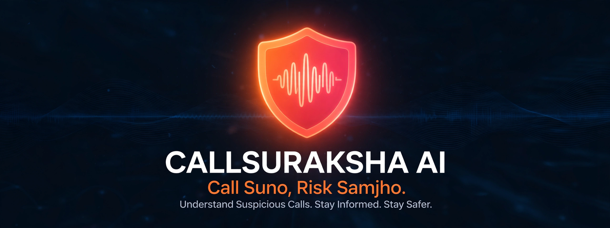
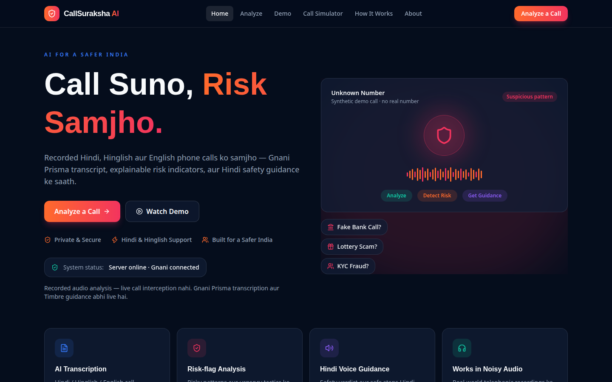
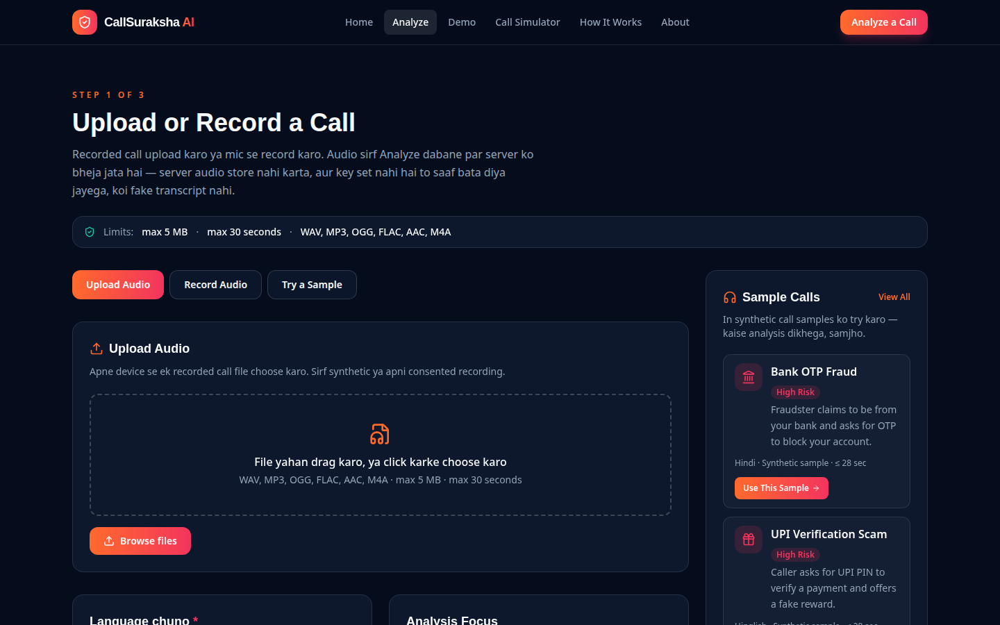
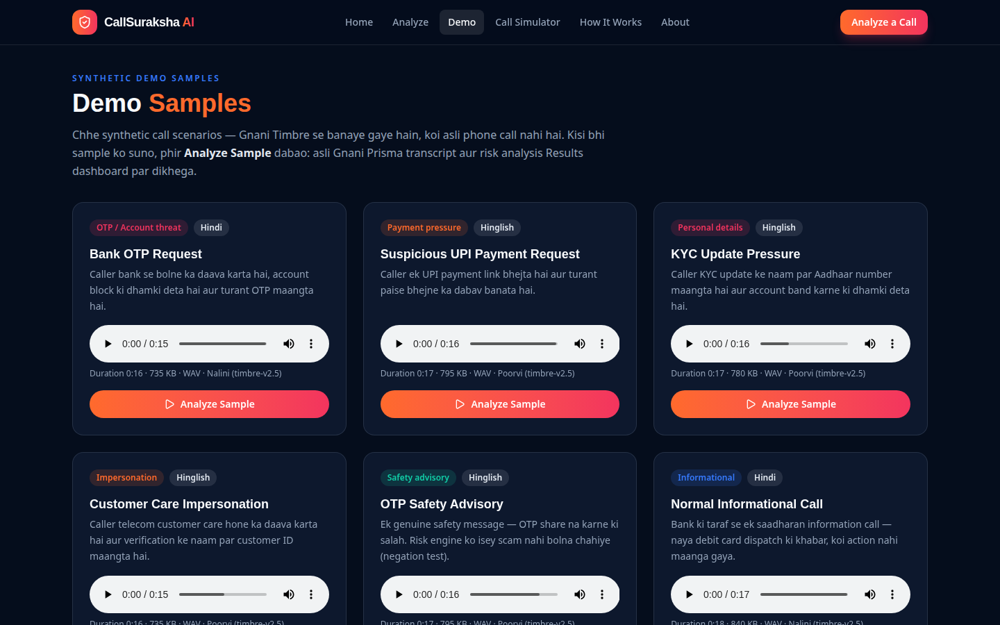
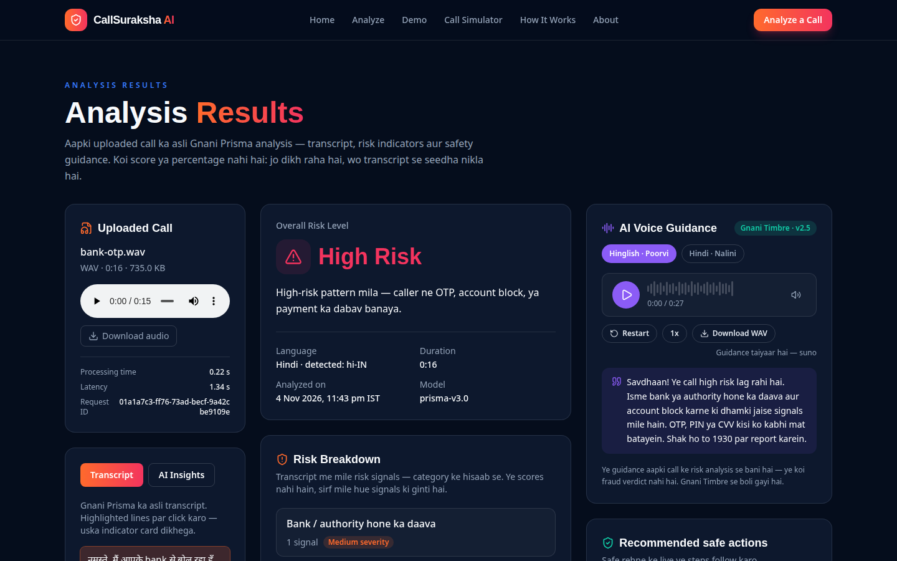
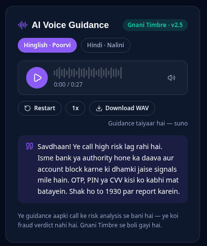
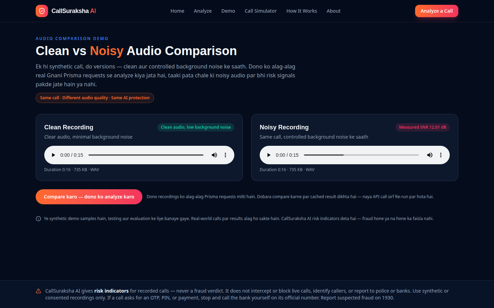
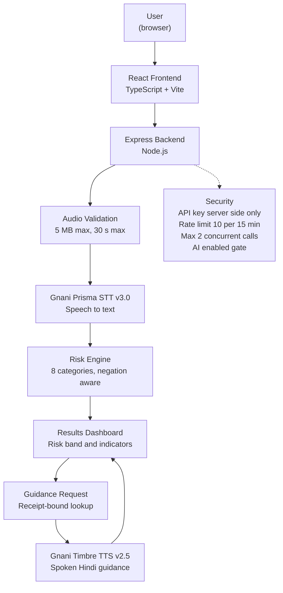

<div align="center">



# CallSuraksha AI

### *“Call Suno, Risk Samjho.”*

**AI-powered fraud-call risk analysis for Hindi, Hinglish & English recorded calls.**

Understand suspicious calls. Stay informed. Stay safer.

[](https://react.dev/)
[](https://www.typescriptlang.org/)
[](https://vite.dev/)
[](https://tailwindcss.com/)
[](https://nodejs.org/)
[](https://expressjs.com/)
[](https://www.gnani.ai/)
[](https://www.gnani.ai/)
[](https://callsuraksha-ai.onrender.com/)

[**🌐 Live Demo**](https://callsuraksha-ai.onrender.com/) &nbsp;·&nbsp; [**🚀 Get Started**](#getting-started) &nbsp;·&nbsp; [**📖 How It Works**](#how-it-works) &nbsp;·&nbsp; [**🔌 API Reference**](#api-reference)

</div>

---

## What is CallSuraksha AI?

CallSuraksha AI helps people understand **suspicious recorded phone calls**.
Upload or record a call, and the app transcribes it with **Gnani Prisma**,
highlights explainable risk indicators with a transparent rule-based engine,
and speaks short Hindi safety guidance with **Gnani Timbre**.

It is built for Indian-language conversations — Hindi, Hinglish and English,
including Devanagari and code-mixed speech, on noisy phone audio.

> **What it is not:** a fraud verdict, a live-call interceptor, a caller-ID
> lookup, a deepfake detector, or an auto-reporting tool. It analyses
> **recorded** audio you provide and flags suspicious *patterns* — nothing more.
> See [Responsible AI & Limitations](#responsible-ai--limitations).

---

## The problem

Suspicious callers use social-engineering tactics that are easy to miss in
the moment, especially on a noisy phone line:

| Tactic | Example |
|---|---|
| **OTP / PIN requests** | “Verification ke liye abhi OTP bataiye.” |
| **Bank impersonation** | “Main aapke bank se bol raha hoon.” |
| **Account-blocking threats** | “Account block ho jayega, warna paisa kat jayega.” |
| **Urgency & pressure** | “Abhi karo, warna…” |
| **Payment requests** | UPI links and instant money-transfer pressure |
| **Personal-data harvesting** | Aadhaar / KYC details asked over a call |

## The solution

```
Recorded Call
      ↓
Audio Processing  (upload / mic recording, 5 MB · 30 s max)
      ↓
Gnani Prisma      (speech-to-text, Hindi / Hinglish / English)
      ↓
Contextual Risk Analysis  (explainable, rule-based, negation-aware)
      ↓
Explainable Risk Indicators  (category · severity · exact sentence · reason)
      ↓
Results Dashboard  (risk band: Low / Medium / High / Unable to Assess)
      ↓
Gnani Timbre      (spoken Hindi safety guidance)
```

Every indicator is linked to the exact transcript sentence that triggered it,
with a plain-language reason and a precaution. No scores, no percentages,
no black box.

---

## Key features

| # | Feature | What it does |
|---|---|---|
| 01 | **Multilingual voice intelligence** | Hindi, Hinglish and English transcripts, including Devanagari and code-mixed speech |
| 02 | **Gnani Prisma integration** | Real speech-to-text (Prisma v3.0, `hi-IN,en-IN`), with model, detected language, processing time and request ID shown |
| 03 | **Explainable risk intelligence** | Deterministic, rule-based engine — 8 categories, sentence-level, negation-aware |
| 04 | **Risk classification** | Low / Medium / High / **Unable to Assess** — a risk flag, never a fraud verdict |
| 05 | **Evidence-based results** | Transcript highlights you can click to see the matching indicator card |
| 06 | **Gnani Timbre voice guidance** | Spoken Hindi safety guidance (Avinash for Hinglish and Hindi), with play / pause / speed / voice switch / download |
| 07 | **Audio upload & recording** | Drag-and-drop upload or in-browser mic recording (30 s auto-stop, preview, re-record) |
| 08 | **Interactive demonstrations** | 6 synthetic sample calls with verified risk bands (3 High, 1 Medium, 2 Low) |
| 09 | **Clean vs noisy comparison** | Same call, clean vs 12.01 dB SNR noise — measured WER 4.3%, CER 3.6%, key-phrase recall 2/3 |
| 10 | **Responsive experience** | Desktop and mobile layouts, verified across 320–1440 px viewports (emulated) |

### 🎙️ Microphone recording — tested compatibility

- **Chromium:** full record → convert → transcribe → results flow verified (29/29 automated checks, fake-mic device).
- **Firefox:** recording flow verified (15/15 checks, fake-mic device).
- Recordings are converted in the browser to **16 kHz mono WAV** before upload
  (Safari `audio/mp4` is used directly as M4A).
- **Not tested:** a genuine human voice on a physical microphone, real Safari,
  and WebKit. These need a real device and are listed as open verification items.

---

## Screenshots

*Captured from the local production build (Nov 2026) with a real Gnani analysis.
The navigation also shows an in-development Call Simulator, which is not yet deployed.*

### Home



### Analyze a call



### Demo samples



### Results — HIGH RISK (real analysis)



*Real run: Bank OTP sample, Prisma v3.0, detected `hi-IN`, High Risk —
OTP demand + account-block threat. Transcript:
“नमस्ते, मैं आपके bank से बोल रहा हूँ, आपका account block हो गया है,
कृपया अपना OTP बताइये वरना आपका पैसा कट जाएगा।”*

### Hindi voice guidance



### Clean vs noisy comparison



---

## 🎬 Demo video

A cinematic product demonstration (64.9 s, 1080p) was produced from real
application footage: simulated incoming call → recorded conversation →
real Gnani Prisma analysis → risk indicators → Timbre safety guidance.
The incoming-call sequence is a **simulated demonstration**; the analysis
shown is a genuine API run. The video file is part of the competition
submission package and is not yet hosted at a public URL — the interactive
demo below is the live equivalent:

👉 **Try it live: [callsuraksha-ai.onrender.com/demo](https://callsuraksha-ai.onrender.com/demo)**

---

## System architecture

One service, one origin. The Express backend serves the built React app
**and** the API, so no CORS is needed and the Gnani key never leaves the server.



**Request flow:** upload/record → server validation → Prisma transcription →
risk engine → results dashboard → receipt-bound Timbre guidance.
Audio lives in memory only; nothing is stored on disk or in a database,
and refreshing the page clears the result.

---

## How it works

| Step | What happens |
|---|---|
| **1. Provide audio** | Upload a recording (WAV/MP3/OGG/FLAC/AAC/M4A) or record with the mic — with consent. Max 5 MB, max 30 seconds. |
| **2. Pick a language** | Hindi, Hinglish or English. No auto-detect — the choice is explicit. |
| **3. Prisma transcribes** | Gnani Prisma v3.0 returns the transcript, detected language, model, processing time and request ID. |
| **4. Risk engine analyses** | A deterministic rule engine scans each sentence for 8 suspicious-pattern categories, with negation handling (a genuine safety warning such as “OTP kisi ko mat batana” is not flagged as a scam). |
| **5. See the evidence** | A risk band (Low / Medium / High / Unable to Assess) plus indicator cards — each with the exact sentence, reason and precaution. |
| **6. Get safe steps** | A short checklist: never share OTP/PIN/CVV, call the bank yourself on its official number, report on 1930. |
| **7. Hear it in Hindi** | Gnani Timbre speaks the guidance (Avinash, Hinglish or Hindi). |

**Three different jobs, three different components:**
*Speech recognition* (Prisma) turns audio into text. *Risk analysis*
(rule engine) finds suspicious patterns in that text. *Voice generation*
(Timbre) speaks the safety guidance aloud. None of them judges guilt —
the output is a risk flag to help you decide what to do next.

---

## Technology stack

| Layer | Technology | Purpose |
|---|---|---|
| Frontend | React 19 + TypeScript + Vite 8 | Single-page app, client routing |
| Styling | Tailwind CSS 4 | Dark cinematic design system |
| Backend | Node.js 20+ + Express 4 | API + static serving, one service |
| Speech-to-text | **Gnani Prisma v3.0** | Multilingual transcription (`hi-IN,en-IN`) |
| Risk analysis | Deterministic rule engine (no ML model) | Explainable, testable pattern detection |
| Text-to-speech | **Gnani Timbre v2.5** | Hindi/Hinglish voice guidance |
| Audio conversion | Web Audio API (client-side) | WebM → 16 kHz mono WAV |
| Testing | Node test scripts + Playwright | Unit, security, E2E and mobile checks |
| Deployment | Render (free tier, single service) | Build + host frontend and backend together |

**Why Prisma and Timbre:** Prisma transcribes noisy Hindi/Hinglish phone
audio with real language detection; Timbre speaks safety guidance in the
same languages the user heard the call in — so the help is understandable
to the people most likely to receive these calls.

---

## Engineering highlights

- **Multilingual transcription** — Prisma v3.0 with `hi-IN,en-IN`, verified
  word-perfect on Devanagari Hinglish; English-only calls detected as `en-IN`.
- **Negation-aware risk detection** — safety warnings, delivery OTPs and
  quoted speech are guarded before any pattern fires (0 false positives on
  the 28-case synthetic suite).
- **Explainable by construction** — every highlight carries category,
  severity, exact sentence evidence, reason and precaution. No invented
  confidence scores or timestamps (the Prisma REST response has neither).
- **Server-side API integration** — the Gnani key is resolved Vault-first
  locally and from an environment variable in production; it never appears
  in the frontend bundle, logs or responses.
- **Request rate limiting** — one combined limiter: **10 AI requests per
  15 minutes per IP** (transcribe + guidance together).
- **Concurrency safeguards** — max 2 Gnani calls in flight; the 3rd gets
  `503 SERVER_BUSY` instead of queuing.
- **Emergency AI switch** — `AI_ENABLED` is fail-closed: only the exact
  value `true` enables paid AI calls. Set it to `false` to stop all Gnani
  usage instantly (demo audio players keep working).
- **Guidance receipt binding** — `/api/guidance` accepts only a
  `{request_id, voice}` pair for a real, recent analysis (10-minute TTL);
  client-sent analysis text is rejected.
- **Audio validation** — format, 5 MB cap and WAV duration (>30 s rejected)
  are checked server-side *before* any Gnani call is spent.
- **Error handling** — Gnani errors map honestly (401/402/403/429/504) and
  the UI shows a readable message plus a text-guidance fallback.
- **Responsive frontend** — verified at 320/375/390/430/768/1024/1440 px
  (emulated), including a fixed ≤375 px overflow on the How It Works page.

---

## Getting started

### Prerequisites

- **Node.js 20+** (`engines: node >=20`)
- A Gnani API key from [app.gnani.ai](https://app.gnani.ai) (for real
  transcription/guidance; the app runs without it, but AI endpoints return 503)

### Setup

```bash
git clone https://github.com/sujalgiriiitp-source/callsuraksha-ai.git
cd callsuraksha-ai
npm install            # frontend deps (root package.json)
```

### Run it

```bash
# Terminal 1 — backend (port 3001)
npm run server         # node server/index.js

# Terminal 2 — frontend dev server (usually http://localhost:5173)
npm run dev            # vite (proxies /api to :3001)
```

> Two terminals are needed in development: Vite serves the frontend and
> proxies `/api` to the Express server. In production a single service
> serves both (`npm start`).

### Test & build

```bash
npm test               # all unit suites (risk, guidance, metrics, samples, security, audio-convert)
npm run build          # tsc + vite build -> dist/
npm run preview        # serve the production build locally
npm start              # production server (serves dist/ + /api on $PORT)
```

---

## Configuration

Copy `.env.example` to `.env` **only on a machine without the Secure Vault**
(e.g. your own laptop). On Render, set the same variables in the dashboard —
never commit a real key.

| Variable | Required | Purpose |
|---|---|---|
| `GNANI_API_KEY` | Yes (for AI) | Gnani API key, server-side only (`X-API-Key-ID` header) |
| `AI_ENABLED` | No — defaults to off | Only the exact value `true` enables `/api/transcribe` + `/api/guidance` |
| `NODE_ENV` | No | `production` also serves the built frontend from `dist/` |
| `PORT` | No (default 3001) | Server port; Render sets it automatically |
| `HOST` | No (default `0.0.0.0`) | Bind host (required on Render) |
| `STAGING_USER` / `STAGING_PASS` | No | Optional HTTP basic-auth gate for the whole service (except `/api/health`) |
| `ALLOWED_ORIGINS` | No (empty = same-origin) | Comma-separated exact origins, only if the frontend is hosted separately |

Variable **names only** are documented here — never put a real value in git,
chat or a screenshot.

---

## API reference

Base URL: same origin as the app (locally `http://localhost:3001`, live
`https://callsuraksha-ai.onrender.com`).

### `GET /api/health`

```json
{ "status": "ok", "gnaniKeyConfigured": true, "keySource": "env" }
```

`keySource` is `"vault"` (local, Secure Vault), `"env"` (production) or
`"none"`. Exempt from the staging gate and the rate limiter.

### `POST /api/transcribe`

Multipart form data — `audio_file` (WAV/MP3/OGG/FLAC/AAC/M4A, ≤ 5 MB, ≤ 30 s),
optional `language_code` (e.g. `hi-IN,en-IN`), optional `model`
(`prisma-v3.0` default, or `prisma-v2.5` — v2.5 accepts a single language only).

```json
{
  "success": true,
  "request_id": "01a19386-…",
  "transcript": "नमस्ते, मैं आपके bank से बोल रहा हूँ…",
  "model": "prisma-v3.0",
  "detected_language_code": "hi-IN",
  "processing_time": 0.77,
  "end_to_end_latency": 0.89,
  "analysis": {
    "riskBand": "High",
    "highlights": [
      { "category": "OTP_DEMAND", "severity": "high",
        "sentence": "…OTP बताइये…",
        "reason": "Caller OTP / PIN maang raha hai — bank ye phone par kabhi nahi mangta.",
        "precaution": "OTP, PIN ya CVV kabhi share na karein." }
    ]
  }
}
```

Error codes: `400 NO_FILE` · `400 FILE_TOO_LARGE` · `400 AUDIO_TOO_LONG` ·
`400` invalid language/model · `429 RATE_LIMITED` · `503 AI_DISABLED` ·
`503 GNANI_KEY_NOT_CONFIGURED` · `503 SERVER_BUSY` · `504` Gnani timeout.

### `POST /api/guidance`

JSON body — `{ "request_id": "<id from /api/transcribe>", "voice": "hinglish" | "hindi" }`.
Returns a WAV file (Timbre v3.0 output, raw 44.1 kHz PCM wrapped server-side — sample_rate 44100 + speed 1.15, the playground pace).
The `request_id` must match a real analysis from the last 10 minutes;
anything else returns `400 INVALID_REQUEST`. Client-sent analysis text is
never trusted.

> **Security note:** never embed a Gnani credential in frontend code.
> The key lives only on the server; the browser only ever calls `/api/*`.

---

## Testing & quality assurance

| Suite | Command | Result (re-run 4 Nov 2026) |
|---|---|---|
| Unit (all) | `npm test` | **254/254** — risk 28, guidance 46, metrics 34, samples 51, security 53, audio-convert 42 |
| Results E2E | `scripts/e2e-results.mjs` | 46/46 |
| Demo + Compare E2E | `scripts/e2e-phase8.mjs` | 52/52 |
| Production E2E | `scripts/e2e-production.mjs` | 39/39 |
| Full UI E2E | `scripts/e2e-phase9.mjs` | 112/112 |
| Mic (Chromium) | `scripts/e2e-mic.mjs` | 29/29 |
| Mic (Firefox) | `scripts/e2e-mic-firefox.mjs` | 15/15 |
| Mobile sweep | `scripts/e2e-mobile-sweep.mjs` | 289/289 (320–1440 px) |

E2E counts above are the verified 31 Oct 2026 runs against the local
production build; the unit suite was re-run on 4 Nov 2026 (254/254).
Live verification after the Phase 6 deploy (1 Nov): all 8 routes 200,
health 200, and a real Bank OTP transcription returned High Risk.

**Honest limits of this evidence:** browser tests run in headless emulation
with fake-mic devices. Real-device Android, a genuine human-voice mic test,
real Safari and WebKit are **not tested**. No accuracy, coverage or
performance percentages are claimed anywhere — the numbers above are test
counts, not product benchmarks.

---

## Security & privacy

- **Keys stay server-side.** The Gnani key is resolved from the Secure Vault
  locally and from an environment variable in production. It never appears
  in the frontend bundle, in logs, in error responses, or in git
  (verified: 0 key-pattern matches in `dist/` and in git history).
- **Audio is not stored.** Recordings live in memory only — on the server
  for one request, in the browser until refresh. No database, no accounts,
  no history.
- **Uploads are validated** before any paid call: file type, 5 MB cap,
  WAV duration check.
- **Abuse controls:** combined 10 AI requests / 15 min / IP, max 2
  concurrent Gnani calls, `AI_ENABLED` fail-closed kill-switch, and
  receipt-bound guidance so forged requests cannot spend credits.
- **Headers:** `X-Content-Type-Options: nosniff`, `X-Frame-Options: DENY`,
  `Referrer-Policy: no-referrer`, `Cache-Control: no-store` on API responses,
  no `X-Powered-By`.
- **Consent:** analysis requires an explicit consent checkbox, and only
  synthetic or consented recordings should be analysed.
- **Known limitations:** rate limiting is per-IP and in-memory (resets on
  restart); receipts are in-memory too. The staging basic-auth gate is
  available but currently off — the live site is intentionally public.
  No absolute security claims are made.

---

## Responsible AI & limitations

- CallSuraksha AI provides **risk indicators, not definitive fraud verdicts**.
  A “High Risk” band means suspicious patterns were found — it is not proof
  of criminal activity, and a “Low” band never means a call is guaranteed safe.
- It analyses **recorded audio you provide**. It does **not** listen to
  ordinary live SIM calls, intercept cellular calls, or integrate with your
  phone app.
- The incoming-call simulator shown in the demo video is a **simulated
  demonstration** (clearly labelled in the video); the analysis underneath
  it is real.
- It does not identify criminals, does not automatically report calls to
  banks or law enforcement, and is not a verified deepfake detector.
- Results can be wrong: Prisma may drop sentences after long silences, and
  the rule engine only catches patterns it knows — a novel scam script with
  no matching pattern scores Low. Always verify a suspicious request
  independently (call the bank yourself on its official number; report on 1930).
- Only synthetic or consented recordings should be analysed. Never upload
  a real call containing personal data without the other party's consent.

---

## Deployment

Live at **https://callsuraksha-ai.onrender.com/** — one Render web service
(free tier) that builds the Vite frontend and runs the Express backend from
the same origin (`render.yaml` blueprint in this repo).

- Build: `npm install && npm run build` · Start: `npm start` ·
  Health check: `/api/health`
- Environment in the Render dashboard: `NODE_ENV=production`,
  `AI_ENABLED=true`, `GNANI_API_KEY` (dedicated production key, `sync: false`),
  no staging gate (public site by decision).
- **Free-tier limits (verified from Render docs):** spins down after 15 min
  idle (~1 min cold start), 512 MB RAM, 750 instance hours/month. Render
  itself says the free tier is not for production use; the first paid step
  is $7/month — not used here.
- Auto-deploy from `main` is on. Deployed commit: `2c6d1774`
  (Phase 6 fixes, live since 1 Nov 2026).

---

## Built for the Great Indian AI Internship Challenge 2026

CallSuraksha AI was built for the **Gnani AI Great Indian AI Internship
Challenge 2026** (submission deadline 10 Nov 2026, 11:59 PM IST).

It uses two Gnani models in a real product flow: **Prisma** for multilingual
speech-to-text on noisy recorded calls, and **Timbre** for spoken Hindi
safety guidance — combined with an explainable, negation-aware risk engine
and Hindi/Hinglish accessibility for the people these scam calls target.

No awards, selections, rankings or internship offers are claimed here —
the competition outcome is decided by the organisers.

---

## Author

**Created by [Sujal Giri](https://github.com/sujalgiriiitp-source)**

- GitHub: https://github.com/sujalgiriiitp-source
- Project: https://github.com/sujalgiriiitp-source/callsuraksha-ai
- Live app: https://callsuraksha-ai.onrender.com/

---

<div align="center">

**CallSuraksha AI — *Call Suno, Risk Samjho.***

Understand suspicious calls. Stay informed. Stay safer.

*Built using Gnani Prisma & Timbre.*

</div>
